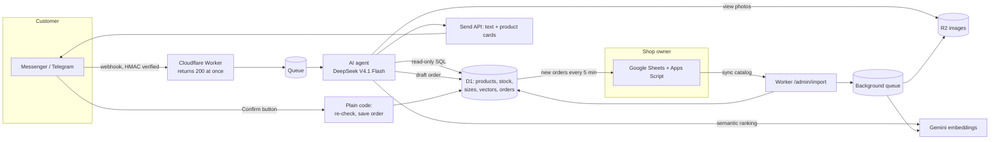

# Fashion Chatbot

AI shopping assistant for clothing shops on **Facebook Messenger** and **Telegram**.
Customers chat in plain Vietnamese ("off-shoulder beach dress under 500k, not black"); an AI agent searches the shop's
live stock, checks product photos when needed, replies with product cards and takes orders in the chat.
The shop owner manages everything from **Google Sheets**. Fully serverless, running on free tiers.

**Portfolio page:** https://tucuong2308.github.io/chatbot-thoi-trang/ · **One-page PDF:** [portfolio.pdf](https://tucuong2308.github.io/chatbot-thoi-trang/portfolio.pdf)
· **Vietnamese docs & full setup guide:** [README.vi.md](README.vi.md)

| Result (40-question independent eval) | |
| --- | --- |
| Correct product in top 3 | **34/34** |
| Average precision / top-3 coverage | 0.89 / 0.86 |
| Hallucinated product codes | **0** |
| Reply time | median ~10 s, 90% under 18 s |
| Cost | ~$0.004 per conversation |

## Features

| Feature | How | Tech |
| --- | --- | --- |
| Natural-language product search | Model writes read-only SQL for hard filters (price, color, type, negations), only in-stock items | DeepSeek, D1 |
| Style advice from vague needs | "Hides the tummy", "for a temple visit" → concrete cuts, ranked by meaning (text + image vectors) | Gemini embeddings |
| Looks at product photos | Checks images in batches of 16 when attributes are not enough | DeepSeek vision, R2 |
| Size & shop questions | Size from height/weight, size chart, shipping, returns, opening hours | D1, Google Sheets |
| Product cards in chat | Photo, price, sizes, buttons; typing indicator while working | Messenger Send API, Telegram Bot API |
| Ordering in chat | Agent drafts order → customer taps **Confirm** → code re-checks stock & price and saves a COD order; look up / cancel orders | Workers, D1 |
| Google Sheets back office | Dropdowns, auto product codes, invalid cells highlighted with a note, sync log | Apps Script |
| Orders back in the sheet | New and cancelled orders pulled every 5 min with chat transcript; email per new order | Apps Script, MailApp |

## How it works



Key design decisions:

- **Model-written SQL is read-only.** One `SELECT`/`WITH` only, write keywords and internal tables blocked, always wrapped in
  `SELECT * FROM (...) LIMIT n`. All 15 attack queries in testing were blocked. D1 is only a copy; the next sync rebuilds it from Sheets.
- **No hallucinated products.** Any product code in a reply must come from a lookup in the same turn, enforced in code.
- **No vector database.** Vectors live in D1 and are ranked in Worker memory after the SQL filter; fast enough for thousands of items.
- **Orders never go through the model.** The model only drafts; confirming, cancelling and validation are plain code.
- **Queue instead of `waitUntil`.** `waitUntil` only gets 30 s after the webhook response; a queue consumer gets 15 min for multi-step agent runs.
- **Model chosen by measurement.** A shared LLM layer supports Gemini and any OpenAI-style API. DeepSeek scored 30/30 vs 21/25
  for Gemini Flash Lite on the same natural-language test set.

## Tech stack

| Area | Technology |
| --- | --- |
| Serverless runtime | Cloudflare Workers (TypeScript), Queues, Cron Triggers, Workers AI, Wrangler |
| Webhooks & channels | Messenger Platform (webhook, Send API, postbacks), Telegram Bot API, HMAC SHA-256 via Web Crypto |
| Data & search | Cloudflare D1 (SQLite), Workers KV (chat history, 7-day TTL), R2 (images), hybrid SQL + cosine ranking |
| AI | DeepSeek V4.1 Flash (agent, tool calling, vision), Gemini (embeddings, fallback model) |
| Back office | Google Sheets, Google Apps Script (menu, triggers, data validation, conditional formatting, MailApp) |
| Testing | Vitest in the Workers runtime (74 tests), Python eval suite with independent test sets |

## Project structure

| Path | Contents |
| --- | --- |
| `src/` | Worker code: agent, tools, SQL guard, channels, orders |
| `migrations/` | D1 schema |
| `apps-script/` | Google Sheets script: Bot menu, sync, order pull, formatting |
| `scripts/` | Python: auto-tag products from photos, build embeddings, demo data, chat from CLI |
| `tests/unit/` | Vitest tests (D1 and KV run locally, no model calls) |
| `tests/eval/` | Independent test sets, scoring script, results |

## Quick start

Requires Node.js 20+ and Python 3.10+.

```bash
npm install
cp .dev.vars.example .dev.vars        # fill in API keys
npx wrangler d1 migrations apply chatbot-thoi-trang --local
npm run dev
python scripts/hoi_thu.py "off-shoulder beach dress under 400k, not black"
npm test
```

Deployment, Messenger/Telegram setup and Google Sheets setup are described in [README.vi.md](README.vi.md) and
[apps-script/README.md](apps-script/README.md).

Demo data: 300 items from the Kaggle *Fashion Product Images* dataset (MIT license); prices, sizes and stock are synthetic.
